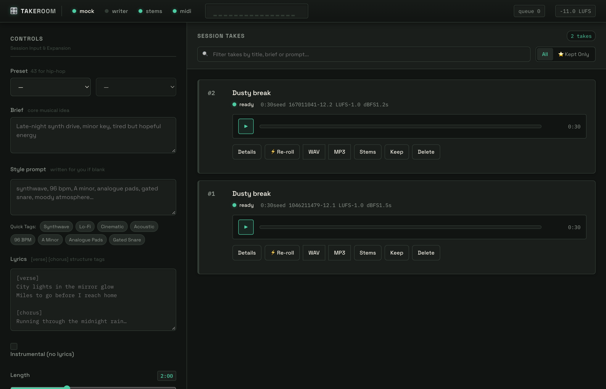

# Takeroom

A local song-generation studio for Apple Silicon. Brief in, mastered stereo
bounce out, with every take logged so you can reproduce it.

Nothing leaves the machine: ACE-Step 1.5 generates the audio on MLX, a local
Ollama model writes the style prompt and lyrics, Demucs splits stems, SQLite
holds the library.

```
brief ──► writer ──► generator ──► mastering ──► library ──► DAW
        (Ollama)    (ACE-Step)    (LUFS +        (SQLite)
                     on MLX        limiter)
```



*The interface with two takes in the session, running on the built-in mock backend.*

## What this is and isn't

It is the orchestration layer — the part that makes a raw model feel like a
product. Queue, prompt expansion, sectioned lyrics, seeded re-rolls, loudness
matching so takes are comparable on the same fader, stems, and a library that
records enough to re-render any take exactly.

It is not a model. The audio quality ceiling is ACE-Step's, which is audibly
below Suno v6. What you get instead is unlimited generation, no subscription,
full commercial rights under Apache 2.0, offline operation, and a codebase you
can fine-tune or bolt onto a JUCE plugin.

## Setup

### 1. ACE-Step

```bash
git clone https://github.com/ACE-Step/ACE-Step-1.5.git
cd ACE-Step-1.5
uv sync
chmod +x start_api_server_macos.sh
./start_api_server_macos.sh          # MLX backend, serves on :8001
```

First run downloads ~10 GB of weights.

**Model choice on 36 GB unified.** The macOS launcher defaults to the 1.7B LM,
which OOMs on smaller Macs — you have the headroom, so leave it. The DiT is the
bigger lever: the XL (4B) models need ≥12 GB and give noticeably better output,
so edit `CONFIG_PATH` in the launcher to `acestep-v15-xl-turbo` once the base
model is working. Don't change both at once, or you won't know which helped.

### 2. Ollama (optional, for the writer)

```bash
brew install ollama
ollama pull qwen3:8b
```

Skip it and write your own prompts and lyrics — Takeroom degrades gracefully and
the lamp just stays off.

### 3. Takeroom

```bash
cd takeroom
cp .env.example .env
./run.sh                              # creates .venv, installs, starts on :8800
```

Then open <http://127.0.0.1:8800>.

### 4. Teach it the API shape

ACE-Step's request fields change between releases. Rather than hard-coding them:

```bash
./.venv/bin/python -m takeroom.discover
```

This reads the server's `/openapi.json`, prints every POST endpoint with its
real field names, guesses the mapping, and writes `data/acestep_mapping.json`.
Check the guesses, fix anything marked `!!`, restart. You never edit Python when
upstream renames a parameter.

## Try it without a model

```bash
TAKEROOM_BACKEND=mock ./run.sh
```

The mock backend synthesises a crude chord loop, so you can exercise the queue,
mastering, library, stems and UI in seconds. Useful for UI work and for proving
a problem is the model rather than the plumbing.

```bash
./.venv/bin/python smoke_test.py      # full pipeline, no model, no network
```

## Using it

Type a brief. Leave the style prompt and lyrics blank and the writer drafts
both — **Draft words only** does that without generating, so you can edit before
committing GPU time.

Two takes per press by default. Everything else being equal, **re-roll** is the
control that actually changes a result: same words, new seed. Hunting for the
right adjective in the prompt is usually worse than rolling three more seeds.

Every take shows its seed, integrated loudness, true peak and render time.
Because all takes land on the same LUFS target, A/B-ing them tells you something
about the arrangement rather than about which one happened to be louder.

Stems run Demucs on the master. As with Suno, the model never produced stems —
this is separation after the fact, and it sounds like it on dense material.

## Configuration

All via `.env` or environment:

| Variable | Default | Notes |
| --- | --- | --- |
| `TAKEROOM_BACKEND` | `acestep` | or `mock` |
| `ACESTEP_URL` | `http://127.0.0.1:8001` | |
| `ACESTEP_API_KEY` | — | only if you started ACE-Step with `--api-key` |
| `OLLAMA_MODEL` | `qwen3:8b` | any chat model you've pulled |
| `TAKEROOM_TARGET_LUFS` | `-11.0` | streaming-ish; use `-14` for reference listening |
| `TAKEROOM_CEILING_DBFS` | `-1.0` | limiter ceiling |
| `TAKEROOM_DEMUCS_MODEL` | `htdemucs` | |
| `TAKEROOM_DATA` | `./data` | library, renders, stems |

## Layout

```
takeroom/
  config.py            env-driven settings
  main.py              FastAPI routes
  jobs.py              single-worker queue; one generation at a time
  writer.py            Ollama prompt expansion + lyric writing
  mastering.py         DC removal, LUFS normalise, lookahead limiter, fades
  library.py           SQLite; one row per take, enough to re-render it
  stems.py             Demucs wrapper
  discover.py          reads ACE-Step's OpenAPI spec, writes the field mapping
  backends/
    acestep.py         HTTP client, mapping-driven
    mock.py            synthetic generator for testing
  static/              the interface
smoke_test.py          end-to-end test on the mock backend
DESIGN.md              interface notes
```

Deliberate choices worth knowing about:

- **One worker.** The model owns the GPU. Two concurrent jobs on a Mac means
  both swap and both are slow.
- **Mapping file, not hard-coded fields.** ACE-Step is moving fast.
- **Mastering is not optional.** Raw output is quiet, DC-offset and hard-cut at
  both ends. This step is most of the difference between "a generation" and
  "a bounce".
- **Paths never reach the browser.** The API serves files by take id.

## Known limits

- Interrupting the server mid-render loses that take; jobs aren't resumable.
- Extend and inpaint aren't wired up. ACE-Step supports repaint and cover; the
  hooks belong in `backends/acestep.py` alongside `generate`.
- The resampler is linear unless you `pip install soxr`. It only fires when the
  model's rate isn't 44.1 kHz.
- Demucs on `mps` occasionally falls over on long files. Pass `device: "cpu"`
  in the stems request if that happens.

## Licence note

ACE-Step 1.5 weights are Apache 2.0, so output is yours commercially. If you
swap in another backend, check first — MusicGen's released weights are
non-commercial, and LeVo/SongGeneration is more restrictive still.

The Takeroom code itself is MIT-licensed. See `LICENSE`.

## Audio to MIDI

Once a take has stems, transcribe them:

```bash
curl -s -X POST localhost:8800/api/takes/<id>/midi -H 'Content-Type: application/json' -d '{}'
```

Or click **MIDI** on the take (appears once stems exist; shift-click quantises
to 1/16). Files land next to the stems and download from the take row.

The strategy depends on the stem, because one transcriber is wrong for all of
them:

| stem | method | expect |
| --- | --- | --- |
| bass | YIN monophonic | reliable, including below E1 |
| drums | onset detection + band classification | kick/snare/hat solid; toms and cymbals approximate |
| vocals | YIN monophonic | melody yes, phrasing no |
| other | basic-pitch if installed, else monophonic | polyphonic needs the optional install |

Tempo is taken from the drums stem and applied to every part, so they import on
one tempo map. Override with `{"bpm": 92}` when you already know it.

Quantisation is off by default. `{"quantize": 4}` snaps to 1/16, `2` to 1/8,
`1` to 1/4; `{"quantize_strength": 0.5}` pulls halfway instead of snapping hard,
which keeps some feel.

Drums are written to channel 10 on the GM map (36 kick, 38 snare, 42 closed hat,
46 open hat, 45 tom, 49 crash), so they land correctly on Groove Agent without
remapping.

For polyphonic transcription of the `other` stem:

```bash
./.venv/bin/pip install "basic-pitch[coreml]"
```

It's optional — everything else works without it, and the status endpoint
reports whether it's present.

**What to expect.** Bass and drums come out usable. Vocals give you the melody
but not the phrasing. Dense polyphonic material needs editing. This is an
estimate, not a transfer — treat the output as a starting part.

## Takeroom.app

```bash
python3 build_app.py --check       # validate the setup first
python3 build_app.py               # build into ~/Applications
```

Double-clicking starts ACE-Step, starts Takeroom, waits for both, and opens the
browser. Quitting stops whatever it started — services you launched yourself in
a terminal are left alone.

The bundle **references** this directory, it does not copy it. That keeps it at
a couple of hundred KB, avoids duplicating the ~10 GB of checkpoints, and means
edits here take effect on next launch instead of silently running stale code
until you rebuild. Rebuild only when paths or ports change.

Logs go to `logs/app.log`, `logs/acestep.log`, `logs/takeroom.log`.

First launch: right-click the app and choose Open, once, to get past Gatekeeper.
It's unsigned and unnotarized — fine for this machine, not for distribution.
